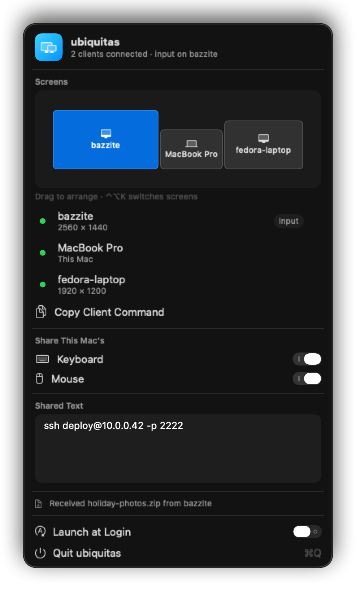

# ubiquitas

One keyboard and mouse, every computer. A very small software KVM.



- `macos/`: server, Swift/SwiftUI. Captures this Mac's keyboard and mouse.
- `linux/`: client, Rust/GTK4. Replays input through virtual `uinput` devices, so it works on X11 and Wayland (Bazzite, Fedora, Ubuntu).
- Windows client: planned, same protocol.

## Features

- **Screen edge switching**: arrange the screens and the cursor moves across edges as if they were one desktop. Every app shows the arrangement and can drag screens; the server snaps a dropped screen flush against its nearest neighbour.
- **Both directions**: a Linux machine's own keyboard and mouse can drive the Mac (and other clients) too. It uses the InputCapture portal (KDE Plasma 6.1+, GNOME 45+): pushing the cursor into an edge that touches a neighbour hands input over; it comes back when the cursor returns. Games with a locked cursor never trigger it. **⌃⌥K** on the Linux machine always takes its input back.
- **Choose what to share**: keyboard, mouse or both (Mac app toggles). Without the mouse, **⌃⌥K** moves keyboard focus to the next screen.
- **Shared text**: a text pad in every app, editable by everyone; the last edit wins.
- **File sending**: drop a file on a screen in the arrangement, or use *Send file…*. Files land in the receiver's Downloads folder and never overwrite existing files.

## Run

**Mac (server)**

```sh
macos/build.sh             # builds macos/ubiquitas.app (Xcode 27, macOS 26.6+), a menu bar app
open macos/ubiquitas.app
```

On first start macOS asks to give ubiquitas Accessibility access; allow it, then click *Check Again* in the panel.
*Copy Client Command* puts the command for a client, including the key, on the clipboard.
The panel is built from [paritas](https://github.com/sovrin/paritas), the shared menu bar components; Xcode fetches it.
The app icon is drawn by `swift tools/make-icon.swift` (run in `macos/`); `swift test` in `macos/` runs the tests.

**Linux (client)**

Ready-made x86_64 binary, built on the Mac in a Fedora 43 container (needs Docker; runs on glibc 2.34+ with GTK 4.10+):

```sh
linux/build-linux.sh   # → linux/dist/ubiquitas
```

Or build on the Linux machine with Rust and GTK 4.10+ headers (`gtk4-devel` on Fedora/Bazzite toolbox, `libgtk-4-dev` on Ubuntu 24.04+):
`cd linux && cargo build --release`. Then run:

```sh
UBIQUITAS_KEY=<key from the Mac> ./ubiquitas <mac-hostname-or-ip>
```

The client reconnects by itself. It names itself after the hostname; set `UBIQUITAS_NAME` if two machines share one.
It needs write access to `/dev/uinput`. One-time setup that gives the logged-in user access:

```sh
echo 'KERNEL=="uinput", TAG+="uaccess"' | sudo tee /etc/udev/rules.d/70-ubiquitas.rules
sudo udevadm control --reload && sudo udevadm trigger /dev/uinput
```

Set the same keyboard layout on both machines: physical key positions are sent, the client's layout decides the character.

## Protocol (v2)

TCP port **24242**. All integers big-endian.

**Key**: 32 random bytes, shared out of band as 64 hex characters (`~/.config/ubiquitas/key` on the Mac).

**Handshake**
1. Server → client: 32-byte random `salt_s`.
2. Client → server: 32-byte random `salt_c`, then frame 0 (key `c2s`): a `hello` control message. The server drops the connection if it doesn't decrypt.
3. Session keys: `HKDF-SHA256(ikm = key, salt = salt_s ‖ salt_c, info = "ubiquitas v2 s2c" | "ubiquitas v2 c2s", 32 bytes)`.

**Frame**: `u32 length (≤ 1 MiB) ‖ ChaCha20-Poly1305(ciphertext ‖ 16-byte tag)`, nonce = 4 zero bytes ‖ `u64` counter.
The counter starts at 0 per direction and is never sent; any reordered, replayed or forged frame fails to decrypt and ends the session.

**Messages** (first byte = type)

| Type | Direction | Bytes | Meaning |
|---|---|---|---|
| `1` | s→c | `u16 x, u16 y` | absolute pointer position on the client's screen, 0..65535 |
| `2` | both | `i16 dx, i16 dy` | scroll in wheel clicks; +dy = up, +dx = right |
| `3` | both | `u16 code, u8 down` | key or mouse button, as Linux evdev code (`KEY_*`, `BTN_*`) |
| `4` | both | UTF-8 JSON | control message, see below |
| `5` | both | `u32 id, bytes` | file data for transfer `id` |
| `6` | c→s | `f32 dx, f32 dy` | relative pointer motion from a client's captured mouse |

Types 2, 3 and 6 from a client only count while that client's input is captured (after `enter`).

Control messages are one JSON object; `t` names the kind, unused fields are absent or `null`:

| `t` | Fields | Meaning |
|---|---|---|
| `hello` | `name, w, h` | client's name and logical desktop size; first frame only |
| `layout` | `screens: [{name, x, y, w, h, online}]` | s→c: current arrangement. c→s: requested positions; the server snaps and rebroadcasts |
| `clip` | `text` | full shared text after an edit; the server forwards it to everyone else |
| `file` | `id, name, size, to` | starts a transfer of `size` bytes, followed by type-5 chunks; the server relays it when `to` is another client |
| `enter` | `x, y` | c→s: the client's keyboard and mouse were captured at its edge, cursor at (x, y) on its screen; the server moves them across that edge |
| `release` | `x, y` | s→c: give input back to the client's desktop with the cursor at (x, y). c→s (no fields): the client took it back itself (⌃⌥K) |

Unknown message types and control kinds are ignored. Evdev codes were chosen as the shared key codes because Linux
uses them directly and for most keys they equal PC scancodes, which is what a Windows client will need.

The arrangement is a global coordinate space (y down) in logical pixels; each machine is one rectangle the size of its
whole desktop. The server tracks one cursor in that space and switches screens when it crosses an edge.

**Test vector**: key `01`×32, salt `02`×64, info `ubiquitas v2 s2c`, counter 7, plaintext `03 00 1e 01` (KEY_A down)
→ `7d09d8a5ff27ae7596b7277d5f550410f3b5968d`. Checked in `linux/src/net.rs` tests.

## Tests

```sh
cd macos && swift test
cd linux && cargo test
```
